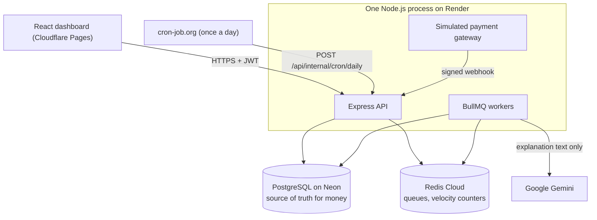
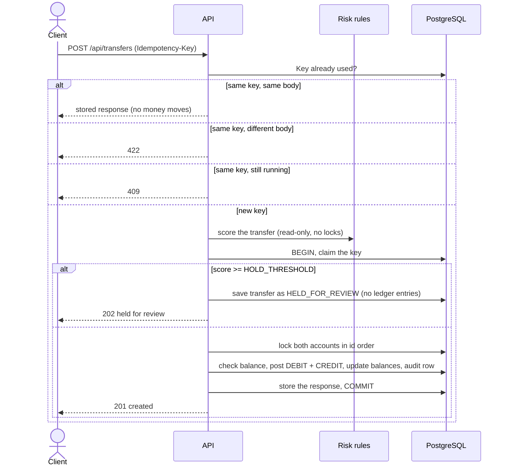

# BalanceGuard Core

A payment backend built around a **double-entry ledger**. Transfers are safe to retry, money never moves twice, every change is audited, and a separate rule-based **risk engine** can flag suspicious payments for a human to review. It runs on free cloud services (Neon, Redis Cloud, Render, Cloudflare Pages), with no Docker and no local database.

**Stack:** Node.js + Express, PostgreSQL (plain SQL, no ORM), Redis + BullMQ, React + Vite + Tailwind, Google Gemini (`gemini-3.1-flash-lite`, optional, only writes explanations).

> **Live demo:** _add your Cloudflare Pages URL here after deploying_
> The free hosting sleeps when idle, so the first request can take up to a minute. The dashboard shows a "server is waking up" screen while it starts.
> Demo logins are shown on the login page when `DEMO_MODE=true`. The data is fake.

## What it does

- **Double-entry ledger.** Every money movement posts one debit and one credit in a single database transaction, so total debits always equal total credits.
- **Idempotent API.** A request with the same `Idempotency-Key` gets the same answer, so a retry after a lost response cannot move money twice.
- **Refunds and reversals** that add new entries instead of editing old ones.
- **Webhooks** from a simulated payment gateway: signature check, duplicate protection, background processing with retries.
- **Reconciliation** that compares our ledger with the gateway's settlement report and lists differences (`MISSING_IN_INTERNAL`, `MISSING_IN_PROVIDER`, `AMOUNT_MISMATCH`, `DUPLICATE_EXTERNAL`). It never changes a balance by itself.
- **Risk engine.** Rules score each transfer from 0 to 100. A high score holds the transfer for a human reviewer. Gemini only writes a short explanation for the reviewer.
- **Audit log** and a ledger **integrity check** (`GET /api/ledger/integrity`).
- **React dashboard** with a risk review queue, reconciliation page and a Demo Lab that replays the failure cases.

## Rules the code follows

1. AI never moves money. The risk module only reads data and returns a score. Approving or rejecting a held transfer is a human action in the `review` module.
2. Money is stored as whole numbers of paise (`BIGINT`). No floats.
3. Every money movement is one transaction that posts balanced entries (`ledger.service.js` is the only place that does it).
4. `ledger_entries` and `audit_log` are append-only: database triggers reject `UPDATE` and `DELETE`. Corrections are new reversing entries.
5. The same idempotency key always gives the same result.
6. PostgreSQL is the only source of truth for money. Redis holds counters and job queues, so losing Redis cannot create a wrong balance.
7. No secrets in git. Real values live in `.env` files and in the hosting dashboards.

## Architecture



On Render's free plan there is only one web service, so the API and the background workers run in the same process (`RUN_WORKER=true`) and the payment gateway is a module inside the backend. It still behaves like an outside system: it keeps its own table of payments, and it tells the API about results with HMAC-signed webhooks that the API verifies.

### Project layout

```
backend/src/
  config/        env validation, database, Redis, logger
  db/            migrations (plain SQL), migration runner, seed data
  jobs/          BullMQ queues and workers
  middleware/    error handler
  modules/
    accounts/ auth/ audit/ ledger/ idempotency/
    transfers/ refunds/ webhooks/ reconciliation/
    risk/        scoring rules and the AI explainer (never touches the ledger)
    review/      human approve / reject of held transfers
    gateway/     simulated payment provider
  utils/         AppError and request validation helper
backend/scripts/ demo and load-test scripts (HTTP only)
frontend/src/    pages, components, API client
docs/            cloud setup and deployment guides
```

### Life of a transfer



## What happens when things go wrong

| Problem | What happens |
|:---|:---|
| Server crashes in the middle of a transfer | PostgreSQL rolls the whole transaction back. A retry starts clean. A key left `IN_PROGRESS` by a crashed server is taken over after 60 seconds. |
| Redis is down | The risk engine skips the velocity check and marks the result `signals_incomplete`. Transfers still work. A webhook that could not be queued stays `RECEIVED` and the daily job queues it again. |
| Neon is asleep | The server retries the connection for up to 60 seconds while Neon wakes up. |
| Provider sends the same webhook twice | `webhook_events.provider_event_id` is unique, so the second one is ignored with a 200. |
| Client reuses a key with a different amount | The request body hash differs, so the API answers 422. |
| Two transfers between the same wallets at once | Accounts are always locked in ascending id order, so they cannot deadlock. |
| A payout fails at the bank | The webhook triggers a reversal in the same transaction that marks the webhook processed. |

## Design notes

- **Why PostgreSQL?** Balancing several accounts needs real transactions and row locks (`SELECT ... FOR UPDATE`).
- **Why a cached `balance` on `accounts`?** Summing the ledger on every read gets slower as history grows. The cached value is updated in the same transaction as the entries, and the integrity endpoint checks that it still equals the sum of the entries.
- **Why score risk before the transaction?** Locks are held only for the short moment of the final writes, not while reading history or calling Redis.
- **Why does reconciliation not fix anything?** Differences are often timing issues. Changing money automatically from a bad file would be dangerous, so a person decides on a correction.
- **Why one process plus an external cron?** Render's free plan allows one service and it sleeps. A daily call from cron-job.org wakes it and starts reconciliation.

## Security notes

- **Strict Role-Based Access Control (RBAC):** There are only two staff roles: `admin` and `reviewer`. Only `admin` can create transfers, top-ups, payouts and refunds. `reviewer` can only access the review queue (to approve or reject held transfers) and view audit logs and reports. Non-staff roles do not exist.
- **Reviewer Separation of Duties:** A reviewer is strictly prohibited from approving or rejecting any transfer they initiated, own, or receive. In the live demo:
  1. Log in as **admin** (`admin@balanceguard.local`) to create a transfer that triggers a risk hold ($\ge 75$), or click **Send Suspicious Transfer** in the Demo Lab.
  2. Switch / log in as **reviewer** (`reviewer@balanceguard.local`) to view the **Review Queue** (`/review`), review the AI explanation, and submit an approval or rejection.
- Webhooks are verified with HMAC-SHA256 over the raw body, compared with `crypto.timingSafeEqual`.
- Platform accounts change only through top-ups, payouts, refunds and webhooks. Customer wallets cannot hold negative balances.
- The cron endpoint requires the `X-Cron-Secret` header.
- General API calls are rate limited (configurable via `RATE_LIMIT_MAX`, skipping secret-protected webhook and cron callbacks).
- Prompts sent to Gemini contain no names, emails or account numbers.
- Database triggers prevent `UPDATE`, `DELETE`, and `TRUNCATE` on `ledger_entries` and `audit_log`.
- **Production Guardrails:** In `production`, `JWT_SECRET`, `WEBHOOK_SIGNING_SECRET`, and `CRON_SECRET` must be at least 32 characters; seeded passwords must be at least 12 characters; and `DEMO_MODE=true` is rejected unless explicitly enabled via `ALLOW_PRODUCTION_DEMO_MODE=true`.

## Run it locally

You need Node.js 20+ and free accounts on Neon, Redis Cloud and Google AI Studio. See [docs/cloud-setup.md](docs/cloud-setup.md).

```bash
git clone <your-repo-url> balanceguard-core
cd balanceguard-core

cp backend/.env.example backend/.env      # fill in your cloud database and redis URLs
cp frontend/.env.example frontend/.env

npm install --prefix backend
npm install --prefix frontend

npm run migrate --prefix backend    # create the tables
npm run seed --prefix backend       # demo users, wallets and Rs 10,000 for Alice

# In one terminal:
npm run dev --prefix backend        # API on http://localhost:4000
# In a second terminal:
npm run dev --prefix frontend       # Dashboard on http://localhost:5173
```

### Demo scripts

These use only the HTTP API. Add `API_URL=https://...` and `ADMIN_PASSWORD=...` to point them at a deployed server.

```bash
npm run smoke-test       # health, login, a transfer, a retry, ledger balance
npm run demo:parallel    # 50 simultaneous requests with one key: money must move once
npm run benchmark        # 50 transfers, prints p50/p95/p99 (adds fake transfers: not for production)
```

There is no automated test suite yet.

## Benchmark results

Fill these in from your own runs and say where the server ran.

| | Local server, Neon dev, Redis Cloud free | Render free plan, Neon main |
|:---|:---|:---|
| Throughput (transfers/s) | _measure_ | _measure_ |
| p50 / p95 / p99 latency (ms) | _measure_ | _measure_ |
| Failed requests | _measure_ | _measure_ |

`npm run demo:parallel` returns a different mix of 201 and 409 each time. What must always hold is that the money moved exactly once.

## Known limitations

- **JWT in browser storage:** For simplicity in this demo, JWT tokens and user metadata are stored in `localStorage`. In high-security production environments, prefer `httpOnly`, `Secure`, `SameSite=Strict` cookies with CSRF defense.
- **In-process mock gateway:** The simulated payment gateway (`gateway.service.js`) runs in the same Node.js process and delivers signed webhooks over local HTTP, mimicking an external provider like Razorpay without requiring a live third-party bank contract.
- **Free-tier cold starts:** Render and Neon sleep after periods of inactivity on free plans. The initial wake-up can take up to 60 seconds; the frontend includes an automatic polling screen until `/health` answers.

## Deployment

Step-by-step guide for Render, Cloudflare Pages and cron-job.org: [docs/deployment.md](docs/deployment.md).
